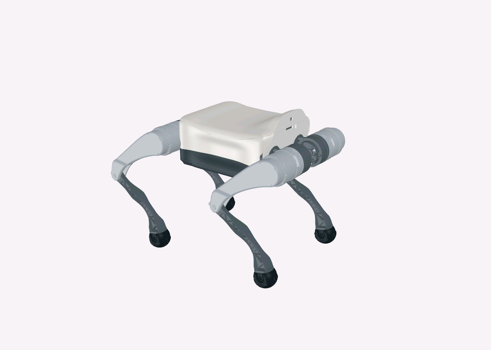
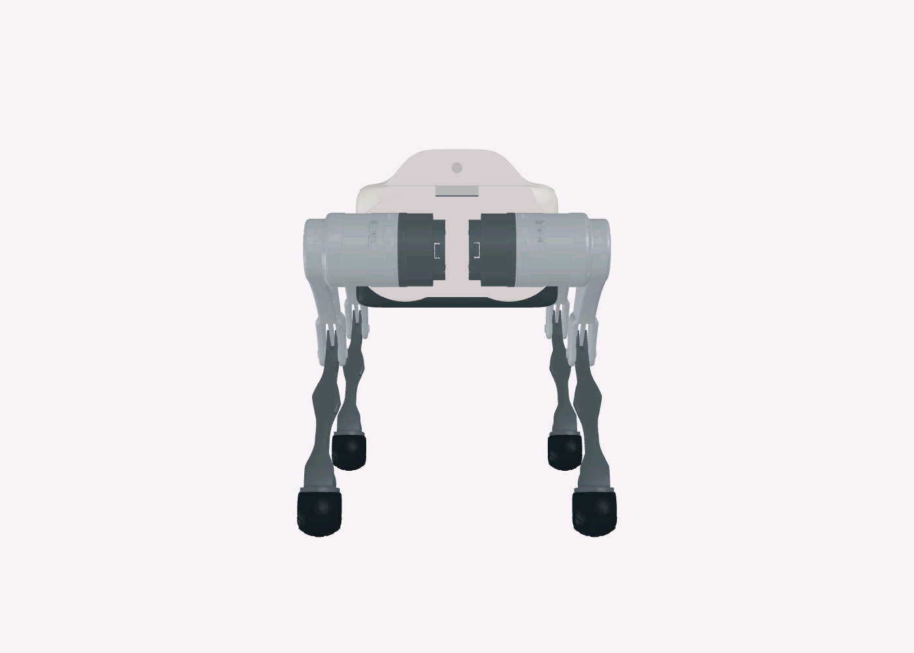
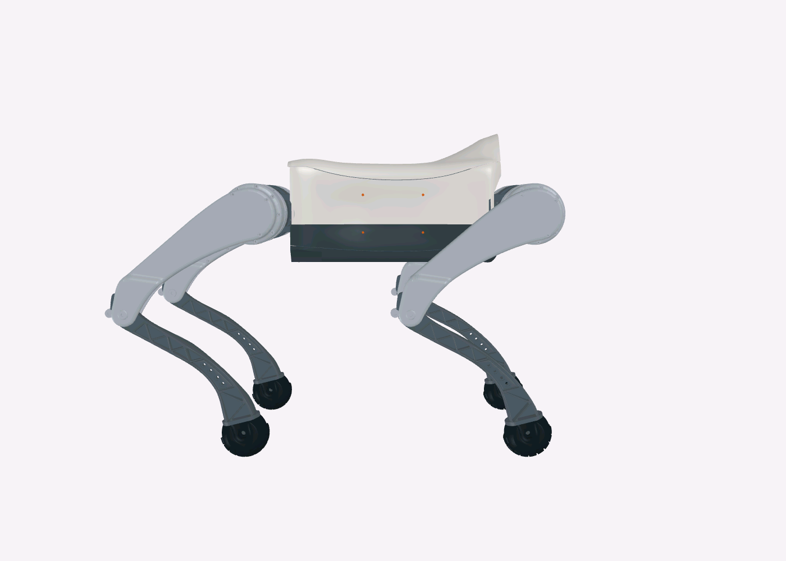

# ORIX · 无头版 SmallDog V67

本分支发布当前无头仿真模型 **`v67_sim_r5_headless`**：12 个关节、完整相对路径 URDF 与 mesh、质量/惯量参数及默认站姿。头壳、面罩、耳朵、摄像头外观、头部支架/紧固件和原 0.2 kg 头部电子负载均已移除。



上图由本分支实际 URDF 和默认关节角生成，是静态 FK 预览，不是策略回放。

| 正面 | 侧面 |
| --- | --- |
|  |  |

## 模型文件

| 内容 | 路径 |
| --- | --- |
| **URDF** | [smalldog_v67.urdf](training/v67_cts/assets/smalldog_v67/urdf/smalldog_v67.urdf) |
| **mesh** | [meshes/](training/v67_cts/assets/smalldog_v67/meshes/) |
| 质量、重心、惯量、关节限位 | [model_contract.json](training/v67_cts/assets/smalldog_v67/config/model_contract.json) |
| 默认关节角 | [standing_pose.yaml](training/v67_cts/assets/smalldog_v67/config/standing_pose.yaml) |
| 运动配置 | [joint_motion_config.json](training/v67_cts/joint_motion_config.json) |
| 参数与左右坐标说明 | [docs/model.md](docs/model.md) |
| 无头版恢复训练参数记录 | [training/recovery_headless/](training/recovery_headless/) |
| 构建脚本 | [build_asset.py](training/v67_cts/build_asset.py) |
| 检查脚本 | [validate_training_asset.py](tools/validate_training_asset.py) |

## 当前参数

| 项目 | 数值 |
| --- | --- |
| 模型版本 | `v67_sim_r5_headless` |
| 连杆 / 转动关节 | 19 / 12 |
| 标称总质量 | 13.333465 kg |
| 去除质量 | 0.569495 kg，包括 0.2 kg 头部电子件估计值 |
| 躯干 `base_link` 质量 | 3.983246 kg；电池作为独立连杆保留 |
| 电池质量占位 | 1.6 kg |
| 髋关节硬限位 | ±1.05 rad |
| 大腿参考范围 | [-1.57, 3.49] rad，以竖直向下为零、向后摆为正 |
| 右侧大腿 URDF 范围 | [-3.140796327, 1.919203673] rad |
| 左侧大腿 URDF 范围 | [-1.919203673, 3.140796327] rad |
| 右侧 / 左侧小腿范围 | [0.4, 2.1] / [-2.1, -0.4] rad |
| 所有关节力矩上限 | 17 N·m |
| 动作目标窗口 | 硬限位中间 90% |
| calf 总等效传动比 | 2∶1 |

躯干重心和惯量按保留组件重新聚合，并用移除组件的平行轴项独立复核。关节轴和 URDF 零位保持原坐标；大腿参考范围已经按左右符号换算。全零关节姿态不是默认站姿，小腿 0 rad 不在本模型限位内。

## 下载与查看

```bash
git clone --branch codex/headless-v67 --single-branch https://github.com/Kitjesen/orix.git
cd orix
python tools/validate_training_asset.py
```

查看时在 [Robot Viewer](https://viewer.robotsfan.com/) 导入完整的 `training/v67_cts/assets/smalldog_v67` 文件夹，选择 `urdf/smalldog_v67.urdf`。保留 `urdf/` 与 `meshes/` 的相对目录关系。

默认 hips=0；右侧 thigh=-0.6715534335840251、calf=+1.1；左侧 thigh=+0.6715534335840251、calf=-1.1 rad。可在查看器中设置这些关节角查看站姿。

## 恢复训练记录

当前无头版平地恢复实验采用 FR-Net v5，2048 环境、2500 次迭代，从零训练；直立高斯核宽 **0.25**，站姿奖励门槛 **0.1**。各连杆在启动时做 ±10% 质量随机化。额外 **0–5 kg** 负重是后续要求，尚未加入本轮。

[生效配置与验证记录](training/recovery_headless/)供核对模型和训练参数。本分支未发布无头版训练完成的权重，也未将远程 FR-Net 全部运行源码复制到仓库。`training/runtime/` 和既有 R6 release 是原带头版 MoE-CTS 的历史记录，不能视为本次无头恢复训练的代码或权重。

## 验证范围

- URDF 的 35 个 mesh 引用完整，19 个连杆及 12 个转动关节检查通过。
- 去头前后全部关节、默认站姿及所有非躯干连杆保持一致。
- 惯量正定；总质量、重心、惯量与模型合同一致。
- Isaac Sim 4 环境 × 20 控制步通过新 USD、质量、限位、动作窗口和 17 N·m 检查。
- 当前恢复训练实际保存的配置通过 14 项检查。

验证记录在 [training/recovery_headless/validation/](training/recovery_headless/validation/)。这些检查不包含全行程 CAD 干涉扫描、实机验证或训练收敛结论。

## 原始设计与历史版本

`design/v67_continuous_head_tail/` 保留带头的原始 CAD 设计与分件，是本模型的构建来源；无头状态由当前 URDF 和构建脚本定义。本分支保留的旧头部网格没有被当前 URDF 引用。原带头版图片保留在 `docs/images/`，当前无头图片位于 `docs/images/headless/`。

原 MoE-CTS R6 源码和发布记录见 [历史训练说明](training/README.md)及 [R6 release](https://github.com/Kitjesen/orix/releases/tag/v67-r6-16100)。原工程来源为 [Cain-A/smalldog](https://github.com/Cain-A/smalldog)，第三方代码和许可证见 [THIRD_PARTY.md](THIRD_PARTY.md)。
