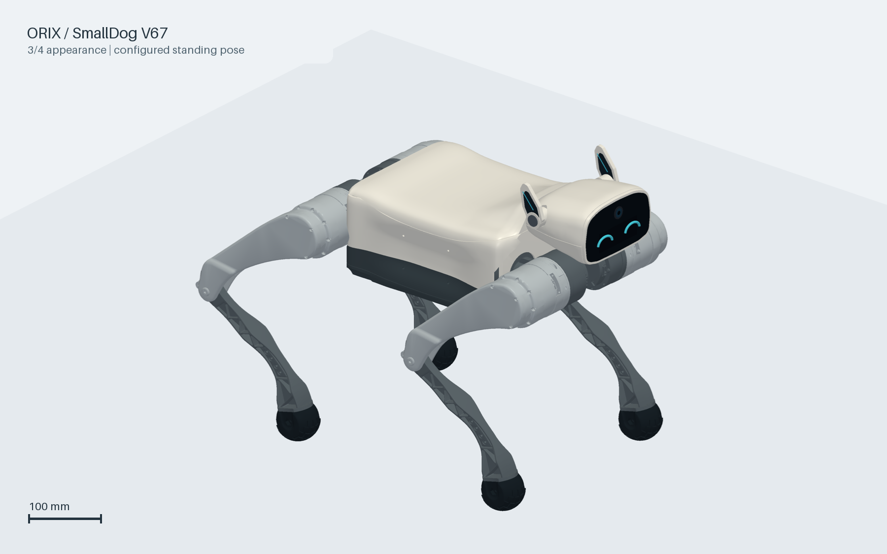
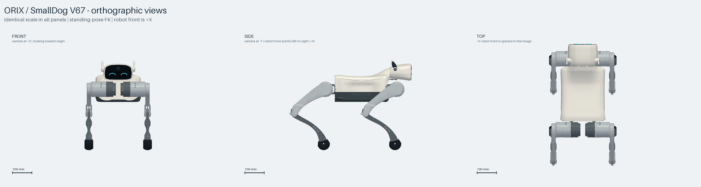

# ORIX · SmallDog V67

自研 12 关节四足机器人的模型、外观 CAD 和 MoE-CTS 训练快照。

**当前资产：`v67_sim_r3`。**包含 V67 外壳、固定可拆头部、机械耳、电池占位和原机械腿。资产内部沿用 `smalldog_v67`、`fr/fl/rr/rl` 等名称，保持与已有训练策略一致。



上图从本仓库实际训练 URDF、mesh、默认关节角和根高度生成，展示当前模型的静态站姿。它不是概念生成图，也不是 Isaac Sim 运动录像。

## 三视图



三幅正交视图采用相同比例尺。机器人坐标为 `+X` 前、`+Y` 左、`+Z` 上；俯视图中前方朝上。

| 正视图 | 侧视图 | 俯视图 |
| --- | --- | --- |
| [原图](docs/images/front.png) | [原图](docs/images/side.png) | [原图](docs/images/top.png) |

## 资源入口

| 资源 | 路径 |
| --- | --- |
| **正式训练用 URDF** | [smalldog_v67.urdf](training/v67_cts/assets/smalldog_v67/urdf/smalldog_v67.urdf) |
| **URDF 所需全部 mesh** | [meshes/](training/v67_cts/assets/smalldog_v67/meshes/) |
| 质量、限位、默认姿态与假设 | [model_contract.json](training/v67_cts/assets/smalldog_v67/config/model_contract.json) |
| 默认关节角 | [standing_pose.yaml](training/v67_cts/assets/smalldog_v67/config/standing_pose.yaml) |
| 当前运动参数来源 | [joint_motion_config.json](training/v67_cts/joint_motion_config.json) |
| V67 外观 STEP / SolidWorks | [design/v67_continuous_head_tail/cad/](design/v67_continuous_head_tail/cad/) |
| V67 外观分件网格和装配记录 | [design/v67_continuous_head_tail/](design/v67_continuous_head_tail/) |
| **训练代码和使用说明** | [training/README.md](training/README.md) |
| 当前 SmallDog 环境与奖励 | [SmallDog 任务源码](training/runtime/source/robot_lab/robot_lab/tasks/smalldog/) |
| **训练权重和下载包** | [V67 R6 / iteration 16100 Release](https://github.com/Kitjesen/orix/releases/tag/v67-r6-16100) |
| 图片生成依据 | [render_metadata.json](docs/images/render_metadata.json) |

URDF 使用相对 mesh 路径，获取时请保留整个资产目录。CAD 装配包含机架、壳体及安装件，腿部完整外观以训练 URDF 为准。

## 当前模型

| 项目 | 当前记录 |
| --- | --- |
| 外观来源 | V67：低位头部、连续肩部与尾部 |
| 运动关节 | 12：每腿 hip / thigh / calf |
| 头部、耳朵 | 本训练版本固定；头部结构可拆 |
| 总质量估计 | 13.902960 kg |
| 电池质量占位 | 1.6 kg |
| calf 总等效传动比 | 2∶1 |
| 默认根高度 | 0.2674918209 m |
| 关节位置软窗口 | 硬范围中间 90% |
| hip / thigh 力矩限幅 | 7 N·m |
| calf 力矩限幅 | 14 N·m |

默认站姿、左右关节符号和限位见[模型说明](docs/model.md)。材料密度、电子件和电池质量含估计值；关节窗口来自模型采样及仿真验证，没有被声明为实测机械止挡或实机控制参数。主板为裸板包络占位，完整器件、线束和散热结构尚未定型。

## 训练快照

本次发布冻结 **`model_16100.pt`**，保留策略、teacher/student 两个优化器以及地形和速度课程状态。它是 R6 中间快照，追加训练的目标最终编号为 `22796`。

- 环境：`RobotLab-SmallDog-V67-RoughR6-v0`。
- 算法：8 专家 MoE-CTS，4096 个并行环境。
- 地形：11 行 × 20 列，等级 0～10；8 类地形。
- 前进速度课程：从 1.0 m/s 逐步解锁至本阶段 1.5 m/s 上限。
- 发布 checkpoint 的实际地形均值：**6.109375**，等级分布及完整元数据见[发布模型记录](training/v67_cts/validation/published_checkpoint.json)。均值不等于各等级的通过率。
- 先前录像暴露了高等级凹坑阶梯失稳，尚未证明全等级稳定通过。

训练基线仍为 Isaac Sim 5.1 / Python 3.11 / Torch 2.7。独立 Isaac Sim 6 录制环境在另一条工作线上准备，当前发布未把正式训练迁移到 Sim 6。兼容性判断见[迁移说明](docs/simulation-migration.md)。

## 获取与检查

```bash
git clone https://github.com/Kitjesen/orix.git
cd orix
python tools/validate_training_asset.py
```

仓库为私有，需要相应 GitHub 访问权限。checkpoint 和可直接转交的打包文件放在 Release，避免把每一轮权重、日志和渲染缓存加入 Git 历史；URDF、mesh、CAD、三视图和训练源码直接保存在仓库中。

## 目录

```text
docs/images/                         当前模型整机外观与同尺度三视图
design/v67_continuous_head_tail/      V67 外观 CAD、网格与阶段记录
training/v67_cts/assets/smalldog_v67/ 正式训练 URDF、mesh、模型配置
training/v67_cts/                    运动参数、资产构建输入、选定验证记录
training/runtime/                   当前 RobotLab / RSL-RL 训练源码快照
training/IsaacLab/                  对应 Isaac Lab 源码、apps 与许可证
tools/                              资产完整性检查、图片生成工具
```

原工程来源为 [Cain-A/smalldog](https://github.com/Cain-A/smalldog)。第三方训练框架及 Isaac Lab 保留各自许可证，来源与版本见[第三方记录](THIRD_PARTY.md)。
